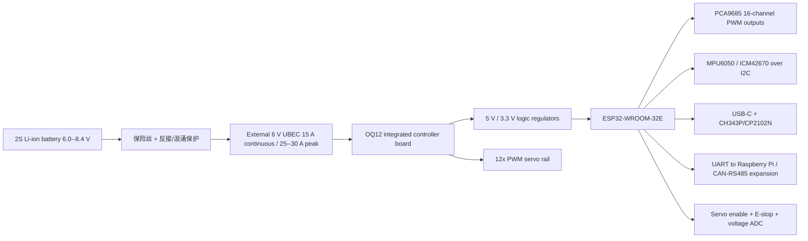

# OQ12 自主四足平台设计方案

> 历史方案（版本 0.1，方案冻结前）：本文件的 ESP32-WROOM-32E、MPU6050/ICM42670、2S 电池、外置 6 V UBEC、12DOF 和 E-stop 均未代表 2026-09-24 已打样的 `Applepy_v1` 实物。当前硬件事实、联调先后、安全缺口见 [BOARD_V1_BRINGUP.md](BOARD_V1_BRINGUP.md)，进度见 [REPLICA_STATUS.md](REPLICA_STATUS.md)。本历史方案保留供决策追溯，不能当作当前固件引脚配置。

版本：0.1（方案冻结前）

## 1. 总体决策

项目代号：`OQ12`（Open Quadruped 12-DOF）。

首版采用 12 自由度、每腿 3 个 PWM 位置舵机、ESP32-WROOM-32E 主控、PCA9685 16 路 PWM 扩展器、MPU6050/ICM42670 IMU、外置 6 V 高电流 UBEC。控制板提供 BiBoard 类似的舵机接口和扩展能力，但不复制 BiBoard 的 PCB。

PCA9685 是有意选择：它把舵机 PWM 从 ESP32 启动脚和无线/串口资源中剥离出来，提供硬件 `OE` 失能和额外 4 路输出。OpenCat 的动作、校准和协议可以保留；仅 `IPwmServo` 的 ESP32 适配实现改为 PCA9685。

### 为什么首版不把大电流降压集成到主板

- 舵机启动和堵转电流远高于 ESP32、IMU 等逻辑负载。
- 将 12 路舵机电源 Buck 放在主板上，会同时引入热、EMI、铜厚、散热和保护设计风险。
- 外置 6 V UBEC 可以先验证机构、步态和软件；其连续电流至少 15 A、短时峰值至少 25--30 A。板载 Buck 放到 V2，在实测电流和热数据明确后再做。

这是降低首版失败概率的工程取舍，不是最终能力限制。

## 2. 目标能力

### 首版必须具备

- 16 路 PCA9685 PWM 输出（首版使用其中 12 路），50 Hz，脉宽约 500--2500 us，可按舵机型号配置。
- 每腿 3 自由度：髋关节外展/内收、髋俯仰、膝俯仰。
- IMU 姿态读取、标定参数保存、倾倒检测和安全停机。
- USB-C 下载和串口日志；BLE/Wi-Fi 参数配置和遥控接口。
- 树莓派/上位机 UART 接口，传输姿态、关节状态和运动命令。
- 电池电压采样、5 V 逻辑/树莓派电源输出、舵机电源独立输入。
- 急停输入、舵机总电源使能、上电默认不动作。
- 关节限位、速度限制、扭矩/电流异常的超时和掉线保护。
- OpenCat 风格的关节编号、校准和步态接口；上层步态代码与硬件适配层分离。

### 第二阶段能力

- 舵机反馈读取（优先通过独立 UART/RS485 总线，而不是把 PWM 反馈强行塞进第一版）。
- CAN-FD 或 RS485 执行器总线扩展。
- 足端触地开关/压力传感器、编码器、ToF 距离传感器。
- ROS 2 bridge、仿真模型、强化学习数据记录。
- 板载 5 V 3 A 或 5 V 5 A Buck；通过温升和负载测试后再定型。

### 首版明确不做

- 不承诺复制 Bittle 外壳、安装孔和关节偏置。
- 不在没有实测数据时承诺动态跳跃、后空翻或全身力控。
- 不把专有 BiBoard PCB 文件当作设计输入。

## 3. 现有开源方案取舍

| 方案 | 可复用部分 | 主要缺口 | OQ12 的处理 |
|---|---|---|---|
| Sesame Robot | Apache-2.0；STL、STEP、BOM、PCB 源文件、Gerber、固件 | 8 舵机，小型机构 | 作为文件组织、许可和构建流程样板 |
| MKme NovaSM3 | 12 舵机 STL、BOM、接线、Gerber/EasyEDA | 仓库没有明确许可证 | 只参考尺寸、接线和测试方法；机械重新建模 |
| ElectroPup | STEP/STL、BOM、KiCad、Gerber、仿真 | BLDC 难度高，许可证需确认 | 留作 V2 执行器/电源研究，不作为首版路线 |
| OpenRoboticDog | STL、Fusion 360、STS3215 清单、固件 | 没有完整自制主控 PCB | 参考 12DOF 关节和舵机反馈需求 |
| OpenCat/BiBoard | 步态、校准、协议、引脚和功能定义 | BiBoard 原理图/PCB/BOM 未公开 | 复用软件接口思想，自制控制板 |

## 4. 系统架构



电源域必须物理分开：`VSERVO_6V`、`VLOGIC_5V`、`VCC_3V3`、`GND`。原始 `VBAT` 只存在于电池到外部 UBEC 的线束中，首版 OQ12 不直接采样它；逻辑地和舵机地在单点大电流回流位置汇接，避免舵机电流从 IMU/USB 地线经过。

## 5. OQ12 控制板 V1 规格

### 5.1 PCB 目标

- 4 层 FR-4，1.6 mm，外层 2 oz；6 V 舵机母线采用整片铺铜和短、宽的回流路径。
- 初版尺寸目标 80 mm x 55 mm，4 个 M2.5 安装孔；尺寸在机械冻结前允许调整。
- OQ12 不承载 12 路舵机的全部降压热损耗；由外置 UBEC 先把 2S 电池降为 6 V。
- OQ12 集成舵机电源分配、12 个三线舵机接口、PCA9685、IMU 和主控；首版没有独立 PWR12 板。
- 舵机 6 V 入口、12 路母线和三线接口位于 PCB 一侧；ESP32、IMU、USB 与 3.3 V 逻辑位于另一侧，以地平面和布局隔离噪声。
- 所有外部连接器有丝印、测试点和可测量的电源域标识。

### 5.2 推荐引脚分配

下表是“兼容 OpenCat 思路”的新设计分配，不是 BiBoard PCB 复制。

| 功能 | ESP32 GPIO | 说明 |
|---|---:|---|
| I2C SDA/SCL | 21 / 22 | IMU、可选 EEPROM、扩展 Grove |
| PWM I2C SDA/SCL | 32 / 33 | 专用 PCA9685 总线，避免 IMU 通信被舵机更新影响 |
| IMU INT | 26 | MPU6050/ICM42670 中断 |
| UART0 | USB 下载 | CH343P 或 CP2102N；ESP32 GPIO1/3 仅在板内使用 |
| UART1 | 25 / 35 | 预留语音/执行器总线；GPIO35 只能作 RX |
| UART2 | 16 / 17 | 树莓派/上位机；经典 ESP32-WROOM-32E 无 PSRAM 时可用 |
| ADC 电池 | 34 | 分压后不超过 3.3 V，增加 RC 滤波 |
| ADC 5 V/舵机电压 | 36 / 39 | 分别监测逻辑 5 V 和外部 UBEC 6 V 输出 |
| SERVO_EN | 13 | 预留给集成高边开关；首版可不装，依赖 PWM_OE 失能 |
| PWM_OE | 14 | PCA9685 与输出缓冲器失能控制，默认上拉关闭 |
| E-STOP | 27 | 独立硬件输入，触发立即撤销 PWM_OE 和 SERVO_EN |
| STATUS LED | 可选，暂不冻结 | 首版使用电源 LED 和 USB 串口日志；避免再占用启动脚 |

说明：最终 GPIO 表必须在原理图审查时以所选 ESP32 模组、启动脚、ADC 输入限制和 UART 复用为准；软件里用 `board_oQ12_v1.h` 集中管理，禁止把 GPIO 散落到步态代码中。

### 5.3 电源和保护

- 电池：2S 7.4 V 锂电池，建议 2200--3000 mAh，持续放电能力不低于 30 A；带保护/BMS。
- 电池到 UBEC 的线束中放置 25--30 A 片式保险丝和总电源开关；这两个器件不需要为此再做一块 PCB。
- 反接保护、输入 TVS 优先由成品 UBEC 或电池线束承担；OQ12 的 6 V 输入增加 TVS 和反接检查丝印即可。
- 舵机 6 V 轨在 OQ12 输入端和母线末端放置大容量低 ESR 电解与陶瓷去耦。
- 外部 UBEC：输入 2S，输出 6.0 V，连续 15 A 以上、峰值 25--30 A 以上；安装在机身而不是用细排线承载电流。
- 逻辑 Buck：输入 6--8.4 V，输出 5 V / 3 A，给主板和树莓派；主板再由 3.3 V LDO 供 ESP32/IMU。
- 急停：锁定式物理总电源开关切断 UBEC 输入；同时 E-stop 信号直接钳位 `PWM_OE`，不依赖 MCU。高边 MOSFET 仅预留封装，放在 V1.1 再验证。
- 5 V 和舵机 6 V 不得通过跳线默认短接；连接器防呆并丝印电压。

## 6. 具体硬件清单

### 6.1 控制板 BOM（1 台）

| 类别 | 推荐器件/规格 | 数量 | 备注 |
|---|---|---:|---|
| MCU | ESP32-WROOM-32E-N16 或等效 16 MB 模组 | 1 | 首版优先经典 ESP32，减少 OpenCat 适配工作 |
| USB-UART | CH343P 或 CP2102N | 1 | Type-C 下载、日志、自动复位 |
| USB 防护 | USBLC6-2 或同等级 USB ESD 阵列 | 1 | 靠近 Type-C |
| PWM 扩展 | PCA9685PW 或 PCA9685 成品验证模块 | 1 | 16 路、12 bit、I2C；地址固定为 0x40 |
| PWM 缓冲 | SN74AHCT125（四路三态缓冲） | 3 | 3.3 V PCA 输出转换成 5 V 逻辑；三态使能接安全链 |
| IMU | MPU6050 模块/裸芯片；预留 ICM42670 封装 | 1 | 首版用 MPU6050，便于 OpenCat 兼容 |
| EEPROM | M24C64-FMC6TG / 24LC64 | 1 | 可选；固件也支持 Flash 模拟 |
| 3.3 V LDO | TLV75733、ME6211 或同等级 500 mA 低噪声 LDO | 1 | 按 ESP32 峰值电流和热设计核对 |
| 5 V Buck | 5 V / 3 A 成品模块或 MP1584/同等级方案 | 1 | V1 可用模块，V1.1 再板载集成 |
| PWM 安全链 | `PWM_OE` 上拉、E-stop 晶体管钳位、缓冲器 `/OE` | 1套 | MCU 失电时 12 路 PWM 必须均为高阻/低电平 |
| UBEC 输入 | XT60/螺丝端子，接入独立 6 V 舵机电源 | 1 | 选型以实测峰值电流决定 |
| 舵机接口 | 3-pin 2.54 mm 排针，V+/GND/PWM | 12 | 接口和电源母线均集成在 OQ12 |
| 舵机母线去耦 | 1000--2200 uF / 16 V 低 ESR + 0.1 uF 陶瓷 | 2--4 | 放在 6 V 输入和连接器区域 |
| 扩展接口 | 2.54 mm Grove/UART/I2C/ADC 排针 | 3--4 | 预留 5 V、3.3 V、GND 和信号 |
| 树莓派接口 | 5-pin UART + 5 V + GND 扩展排针 | 1 | 实际可用引脚按机械位置定 |
| 急停 | 锁定式按钮或外部两线输入 | 1 | 断开舵机使能 |
| 电流检测 | INA219/INA226，先监控逻辑或 UBEC 输入 | 1 | 舵机总电流可用外部传感器 V1.1 增加 |
| 保险/TVS | 保险丝、SMBJ10A 级别 TVS、反接 MOSFET | 各1 | 按实际电池峰值修正 |
| 指示 | 5 V、3.3 V、VSERVO、故障 LED | 4 | 不用过多 RGB 装饰 |
| 机械 | M2.5 安装孔、铜柱、连接器、测试点 | 1套 | 板级装配件 |

### 6.2 机器人整机 BOM（1 台）

| 类别 | 推荐规格 | 数量 | 备注 |
|---|---|---:|---|
| 位置舵机 | DS3218/DS3225 20 kg·cm 级、金属齿、6 V PWM | 12 | 先统一一个型号；不要混用不同中位/角度范围 |
| 舵机臂 | 与舵机齿数匹配的 25T 金属臂 | 12--16 | 备用 4 个 |
| 电池 | 2S 7.4 V 2200--3000 mAh，连续 30 A 以上 | 1--2 | 另一块作为替换电池 |
| UBEC | 2S -> 6.0 V，连续 15 A、峰值 25--30 A 以上 | 1 | 靠近舵机电源入口 |
| 主控板 | OQ12 V1 | 1 | 本方案设计目标 |
| IMU | 板载 MPU6050 | 1 | 机械上靠近机身质心并固定刚性 |
| 树莓派 | Raspberry Pi Zero 2 W / Pi 4（可选） | 0--1 | 视觉、ROS、上位机，不作为闭环安全依赖 |
| 3D 打印 | PETG/ABS/CF-PLA；关键髋部优先高强度材料 | 1套 | 首版允许局部铝板/碳管加强 |
| 轴承 | 625/626 或按 CAD 选型 | 8--16 | 关节支撑，不让舵机轴承担所有弯矩 |
| 螺钉 | M2/M2.5/M3，长度按 CAD | 1套 | 备件比例 20% |
| 线材 | 22--24 AWG 信号，14--16 AWG 主电源，20--22 AWG 分支 | 1套 | 舵机电源不要用杜邦线串接 |
| 外壳/护罩 | 自建 STEP + STL | 1套 | 不复制 Bittle 外壳 |

### 6.3 V2 预留器件

- 12 路串行舵机总线收发器（RS485 或半双工 UART）。
- CAN 收发器（例如 SN65HVD230/TJA1051，按 MCU 电平确认）。
- 电流/电压监测（INA228 级别）和温度 NTC。
- 板载 6 V / 15 A 同步 Buck；只有在外置 UBEC 方案完成实测后引入。

## 7. 机械方案

### 7.1 结构路线

首版不直接承诺 Bittle 外形。采用对 12DOF 3D 打印四足更友好的独立结构：

- 机身：两块 3D 打印侧板 + 中央电池舱 + 上盖；控制板平放在机身上层。
- 每腿：髋外展、髋俯仰、膝俯仰三舵机；左右腿镜像但通过软件关节符号处理。
- 关键舵机安装耳处使用双剪切支撑或轴承，避免打印件悬臂直接承受冲击。
- 电池位于质心附近，UBEC 靠近电池，主控和 IMU 远离大电流开关节点。
- 首版以可维护性优先：拆一条腿不需要拆整机，舵机线可单独更换。

### 7.2 建议初始尺寸包络

- 机身长 230--270 mm，宽 120--160 mm，高 60--90 mm。
- 大腿/小腿有效长度各 80--105 mm；先用可调孔位允许 ±10 mm 调整。
- 站立脚距目标 220--280 mm，整机含电池目标质量 2.0--3.0 kg。
- 结构件首版用 PETG 或韧性 PLA；髋部、舵机耳和膝关节使用金属/碳管加强。

### 7.3 CAD 交付物

必须以 STEP 为主、STL 为打印导出格式，交付：

1. `assembly.step` 总装。
2. 每一腿的左右镜像组件 STEP。
3. 单件 STL、打印方向、层高、填充率和支撑说明。
4. 舵机、PCB、电池、UBEC 的占位模型。
5. 关节零位、限位、装配基准和质量/质心记录。

## 8. 软件和兼容策略

### 8.1 分层

```text
Application: 模式、遥控、任务和安全状态机
Domain: 关节模型、逆运动学、步态、姿态补偿、限位
Interface: IPwmServo, IImu, IPowerMonitor, ITransport, IStorage
Platform: ESP32 LEDC、I2C、UART、ADC、NVS、FreeRTOS 适配
Board: OQ12 V1 引脚、电源使能、连接器和故障输入
```

Domain 层不允许包含 Arduino GPIO、ESP-IDF 类型或具体 GPIO 号。所有板级信息集中在 `board_oQ12_v1.h`。

### 8.2 兼容 OpenCat 的接口

- 关节顺序保持 12 路稳定编号；硬件顺序、逻辑顺序和左右镜像在配置表中显式定义。
- 保留 `calibration offset`、方向符号、最小/最大角度和脉宽映射。
- 保留串口运动命令、姿态读取、校准和技能/动作数据的上层格式；底层 PWM 驱动独立替换。
- 首先移植舵机测试、IMU 读取和静态站立，再移植步态和姿态补偿。
- 任何反馈舵机、RS485 或 CAN 支持都实现为新的 `ActuatorBackend`，不污染 PWM 路径。

### 8.3 固定控制周期

- 1 kHz：系统时基/安全超时。
- 100 Hz：IMU 读取、姿态估计和电压监控。
- 50 Hz：PWM 舵机命令更新。
- 20--50 Hz：步态/逆运动学，首版不追求高频动态控制。
- BLE/Wi-Fi/树莓派通信必须异步，不能阻塞舵机和安全任务。

## 9. 分阶段实施和验收

### 阶段 0：规格冻结

产物：关节编号、坐标系、舵机型号、输入电压、机械包络、连接器和许可记录。

完成标准：所有关键器件均有可购买替代型号；不存在“以后再决定”的电源和舵机选择。

### 阶段 1：控制板验证板

先用 ESP32 开发板 + PCA9685 验证模块 + 5 V 逻辑电源 + 外置 UBEC，不等 PCB 完成。

验证：单舵机 PWM、12 路同时输出、IMU、ADC、USB 下载、急停、5 V 电源和树莓派 UART。

完成标准：舵机电源关闭时 USB/IMU 仍可稳定运行；急停在 10 ms 级别内撤销使能；连续 30 分钟日志无复位。

### 阶段 2：OQ12 PCB V1

产物：原理图、PCB、Gerber、BOM、装配图、测试点清单和生产测试固件。

完成标准：裸板上电无短路；USB 下载成功；各电源域空载/负载符合规格；单路和 12 路 PWM 均通过示波器检查。

### 阶段 3：单腿和机械样机

先装一条腿，验证舵机零位、机械限位、关节方向和负载下的电流。

完成标准：单腿可重复回零；不出现打印件干涉；连续 10 分钟站立测试没有明显温升或结构松动。

### 阶段 4：四腿静态站立

完成 IMU 标定、关节偏置、站立姿态、失联保护和倾倒停机。

完成标准：平地站立 10 分钟；人工轻推后能安全撤销舵机；掉电/重启不会随机甩腿。

### 阶段 5：慢速步态

先直线、转向，再加入姿态补偿和树莓派命令。

完成标准：低速连续行走 20 分钟；电池和 UBEC 温升受控；每次动作可复现，串口能追溯故障。

### 阶段 6：反馈和高级执行器

在 PWM 版本稳定后再接入串行舵机、CAN/RS485 或 BLDC，不修改 Domain 层接口。

## 10. 预算和采购策略

粗略分档（不含打印机和工具）：

- 控制板首版打样和贴片：约 300--800 元，取决于数量和是否使用模块。
- 12 个 PWM 金属舵机：约 600--1,500 元，品质差异很大；先买 2 个做堵转/回差测试，再整套购买。
- 电池、UBEC、线束和保护件：约 250--500 元。
- 结构件打印、轴承、紧固件：约 300--800 元。
- 树莓派和视觉模块：可选，另计。

采购顺序应为：先买 2 个候选舵机和 UBEC 做实测，再冻结电源和机械；不要先一次性买满 12 个。

## 11. 关键风险

1. 低价舵机的回差、堵转电流和中位漂移可能远大于数据表，直接影响步态；必须实测。
2. ESP32 经典模组的启动脚、ADC 限制和 UART 复用会影响引脚表；原理图评审前不可冻结 PCB。
3. 舵机电源噪声可能造成 ESP32 复位和 IMU 异常；必须物理分域、单点接地并记录波形。
4. 没有闭环关节反馈时，不应宣称力控或动态平衡；首版目标是稳定位置控制和姿态补偿。
5. OpenCat 固件的许可允许软件复用，但 BiBoard 的硬件布局和商业标识不属于本项目设计资产。

## 12. 下一步

下一步不是马上画整板，而是完成三个可验证输入：

1. 选定并实测两个舵机候选（电流、回差、速度、脉宽范围）。
2. 用开发板和外置 UBEC 驱动 1 条腿，确认 6 V 电源和机械包络。
3. 在机械和电气输入冻结前，不进入原理图或 PCB 绘制；如重启，先建立独立的需求与实测记录。

完成这三个输入后，才冻结完整 BOM、PCB 尺寸和 3D 机身安装孔。

## 13. 基于 Py-Apple 的复刻路线（冻结版）

### 13.1 目标分叉

Py-Apple 当前舵机主线的可验证目标是 **8DOF**：每腿 1 个髋/大腿舵机 + 1 个小腿舵机，共 8 个 `MG90S`。它与 Dynamics V7.3 的 `PA_IK.py`、`padog.servo_output()` 和 Structure V7/V10 串联腿相互匹配。

OQ12 的 **12DOF** 目标不能直接从 Py-Apple 提取出来：必须新增每腿第三关节、重新做 3D 逆解/姿态映射/通道表、扩大电源和机械包络。因此先把 Py-Apple 当作“8DOF 参考实现 + 控制器/网页/标定协议来源”，不把它误标成 12DOF 成品。

### 13.2 推荐的上游冻结点

| 层 | 上游冻结点 | 复刻输入 |
|---|---|---|
| 控制算法 | `py-apple-dynamics@c69ab76df92a9a162b6608ea0ffb72d23c1e8990` | `PA_IK.py`、`PA_ATTITUDE.py`、`PA_GAIT.py`、`PA_STABLIZE.py`、`PA_IMU.py` |
| 运行时/人机界面 | 同上 | `main.py`、`padog.py`、`web_c.py`、`cal.html`、`control.html`、`config_s.py` |
| 控制器硬件 | `py-apple-controller@83d989b5d24b92cb699e61e1c798fc7b837c6df5` | V4.0 直插版 Altium 文件、PDF、XLSX BOM |
| 机械结构 | `py-apple-structure@84e3048eb545fca0ae44138a09eeb14e54feba5c` | V10.0 串联腿 STL + 同目录 BOM；把“V10”视为包装/外观版本，按 V7.0 8DOF 零件表核对 |

### 13.3 目标工程布局

```text
replica/
  Application/          # 模式、命令、安全状态机
  Domain/               # 8/12DOF 关节模型、IK、步态、姿态控制
  Interfaces/           # IServo, IImu, ITransport, IStorage, ISafety
  Platform/ESP32/       # MicroPython 或 ESP-IDF 适配；GPIO/I2C/UART/ADC
  Board/OQ8_V1/         # V4.0 控制器引脚、PCA9685、舵机电源和急停
  Mechanical/           # STEP 主模型、STL 导出、装配基准、BOM
  Tests/                # 主机 IK/轨迹/协议/限位测试与回放
  docs/                 # 上游证据、校准、验证记录
```

### 13.4 最小垂直切片

Next step: 先恢复 8DOF 单腿的“角度 → PCA9685 PWM”链路。

Files: `PA_SERVO.py` + `padog.py::servo_output` → `Interfaces/IServo`、`Platform/ESP32/Pca9685Servo`、`Board/OQ8_V1/servo_map`。

Goal: 在开发板 + PCA9685 + 外置 5--8 V 电源上，单路和 8 路舵机以 50 Hz 输出，中位/方向/限位可配置。

Verify: 示波器检查频率和脉宽；逐路回零；断开舵机电源时 USB/IMU 不复位；急停输入能关闭 PWM/OE 和舵机电源。

Done when: 不再依赖 `exec()` 或散落 GPIO；8 路通道表、脉宽范围、单位、校准偏置和故障状态都有测试记录。

### 13.5 分阶段复刻与验收

1. **冻结 8DOF 参考样机**：按 V10 STL/V7 BOM 打印一条腿，确认 MG90S 齿数、中位和 6704ZZ 轴承装配。
2. **软件底层**：主机测试 `PA_IK` 串联腿 `case=0`、角度限位、轨迹连续性；再接 MicroPython/ESP32 硬件。
3. **控制器适配**：复刻 PCA9685、MPU6050、ADC、蜂鸣器、UART/遥控输入；将 `CC_M` 互斥改成显式输入源选择。
4. **安全链**：硬件急停、PCA9685 OE、舵机高边/电源开关、低压/过流/看门狗；软件只做第二道保护。
5. **静态站立**：舵机标定、机械限位、IMU 水平校准、站立 10 分钟；记录电流、温升和复位情况。
6. **慢速步态**：先 WALK，再 TROT；验证失联、低压、IK 越界和掉电默认不甩腿。
7. **12DOF 分支（如仍坚持 OQ12）**：在 8DOF 链路稳定后，单独定义三关节/腿的机械坐标、3D IK、12 路通道和电源预算；不得直接修改 8DOF `PA_IK` 的参数数量来“凑 12DOF”。

### 13.6 上游缺陷纳入修复清单

- `PA_SERVO.py` 的 `radians` 分支缺 `math` 导入，`release()` 未覆盖通道 15。
- `web_c.py` 的 HTTP GET 使用 `exec()`，复刻必须改为字段白名单、范围检查和固定命令表。
- `PA_IMU.py` 的采样周期/滤波增益/寄存器配置写死，需抽到配置并处理 I2C 超时与零加速度。
- 低压拟合系数和 5.5 V 阈值没有校准来源，必须用实测分压和舵机电源域重新标定。
- Controller V4.0 的 Altium 工程是可读设计输入，但 BOM 仍以模块名为主，PCB 电流承载、保护和连接器额定值需复核后才能生产。
